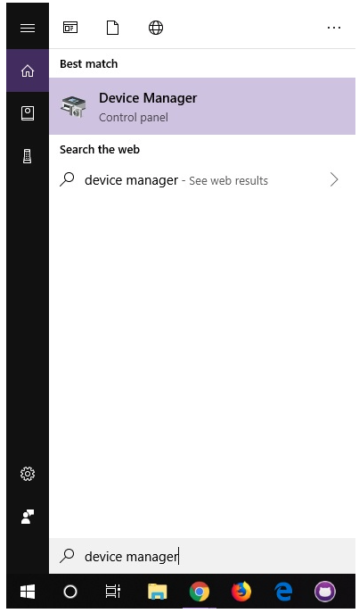
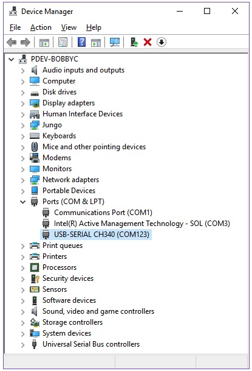
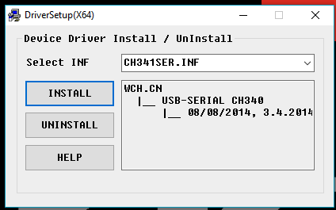

# ESP32-DevKit

## Verificación de controladores para Windows
Para verificar que su controlador esté funcionando, debería ver una diferencia en las siguientes imágenes después de conectar el CH340 a un puerto USB.

## Administrador de dispositivos
Para comprobar que el CH340 se enumera en un puerto COM, puede abrir el administrador de dispositivos. Puede hacer clic en el botón Inicio o (Windows) y escribir "administrador de dispositivos / device manager" para buscar rápidamente la aplicación.

Después de abrir el administrador de dispositivos, deberá abrir el árbol de puertos (COM y LPT). El CH340 debería aparecer como USB-SERIAL CH340 (COM##). Dependiendo de su computadora, el puerto COM puede aparecer como un número diferente.

## Instalación USB Driver ***(Si no reconoce el puerto COM)***

En algunos casos nuestra PC no es capaz de reconocer el dispositivo USB que nosotros conectamos, es por ello que dejaremos un archivo para la instalación del driver con ello nuestra PC deberá ser capaz de reconocer el dispositivo conectado, en caso de que el problema persista asegúrese de que su dispositivo no se este sobre calentando.

[Descarga este driver para Windows][DRIVER_USB]

[DRIVER_USB]: https://cdn.sparkfun.com/assets/learn_tutorials/8/4/4/CH341SER.EXE

1. Descargar el driver 
2. Seleccionar CH341SER.INF
3. Click en la opción ***Install***
4. Cuando este instalado cerrar la ventana y listo.!

Con esto estaría lista la instalación del Driver USB para nuestra tarjeta en el Sistema Operativo Windows.

## Instalación Arduino IDE
1. Abrir ARDUINO IDE
2. Debemos ir a la pestaña ***Archivo***->***Preferencias***.
	- En la pestaña ***Ajustes*** buscamos la opción: ***Gestor de URLs Adicionales de Tarjetas: ***
	- Pegamos la siguiente URL: `https://dl.espressif.com/dl/package_esp32_index.json`
	- Luego presionamos la opción ***OK*** y automáticamente se cerrará la ventana.
3. Debemos ir a la pestaña ***Herramientas***->***Placa***->***Gestor de tarjetas***.
	- Colocamos en la barra de búsqueda ***ESP32***.
	- Seleccionamos la opción que nos muestre ***ESP32 Wrover Module***.
	- Instalamos y luego presionamos la opción de ***Cerrar***.

Con esto tendremos completa la instalación de nuestra tarjeta ESP32 y lista para ser programada.
